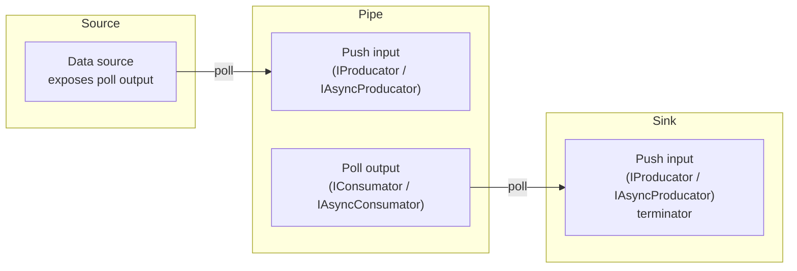

#  Steelax.Pufflow

> ⚡ **Pufflow. Just puff your flow**

[](https://www.nuget.org/packages/Steelax.Pufflow)
[](https://www.nuget.org/packages/Steelax.Pufflow/)

**Pufflow** — a library for building dataflow pipelines based on **Poll** and **Push** data transfer models and their
combinations. Pipeline components are plain classes annotated with `[Flow]`; a Roslyn source generator derives the
compile-time flow shape, and `FlowExt` connects components into type-safe chains.

---

## 📦 Installation

Core package (interfaces, markers, `FlowSource`, `FlowContext`, source generator):

```
dotnet add package Steelax.Pufflow
```

Standard operators (`Map`, `Filter`, `Buffering`, `Chunking`, `Timeout`, `Warming`):

```
dotnet add package Steelax.Pufflow.Operators
```

Kafka integration (`OnKafkaSource` consumer source with watermark progress):

```
dotnet add package Steelax.Pufflow.Operators.Kafka
```

---

## 🧠 Concept

The library defines **4 fundamental interfaces** for passing data between pipeline components.

### Poll (pull)

The Poll interface is the **read side** (output). Data is requested by the consumer.

| Synchronous        | Asynchronous                    |
|--------------------|---------------------------------|
| `IConsumator<T>`   | `IAsyncConsumator<T>`           |

```csharp
public interface IConsumator<T> where T : allows ref struct
{
    bool TryRead([MaybeNullWhen(false)] out T value);  // non-blocking read
    bool IsCompleted { get; }                          // stream ended
}

public interface IAsyncConsumator<T> : IConsumator<T> where T : allows ref struct
{
    ValueTask<bool> WaitToReadAsync();                 // async wait
}
```

### Push (write)

The Push interface is the **write side** (input). Data is sent by the producer.

| Synchronous        | Asynchronous                    |
|--------------------|---------------------------------|
| `IProducator<T>`   | `IAsyncProducator<T>`           |

```csharp
public interface IProducator<in T> where T : allows ref struct
{
    bool TryWrite(T value);                 // non-blocking write
    bool TryComplete(Exception? ex = null); // completion / error signal
    bool IsFull { get; }                    // ring buffer is full
}

public interface IAsyncProducator<in T> : IProducator<T> where T : allows ref struct
{
    ValueTask<bool> WaitToWriteAsync();     // async wait
}
```

### Streaming semantics

- `TryRead` / `TryWrite` return a plain `bool` and do **not** block.
- `IsCompleted` tells whether the pull stream has ended; `IsFull` tells whether the push buffer is full.
- A stage that has no wait primitive simply yields (`await Task.Yield()`) or waits on its async counterpart.

### Cursor

A pull consumer may additionally implement `ICursorable<T>` to peek the current element without committing to it
(useful for retries until the output has capacity) and advance only after it is fully handled:

```csharp
public interface ICursorable<T> where T : allows ref struct
{
    bool TryPeek([MaybeNullWhen(false)] out T value);
    void Advance();
    bool IsCompleted { get; }
}
```

> **Note:** `IEnumerator<T>` / `IAsyncEnumerator<T>` are standard .NET interfaces; Pufflow supports them as a special
> case of the poll model for compatibility (`await foreach` friendly chains).

---

## 🏗️ Pipeline Components

Components in Pufflow fall into **3 roles**, encoded as zero-size marker structs:



| Role       | Marker Type           | Description                                                                     |
|------------|-----------------------|---------------------------------------------------------------------------------|
| **Source** | `Source<T>`           | A component that **only emits** data (poll output)                              |
| **Sink**   | `Sink<T>`             | A component that **only accepts** data (push input) and terminates the pipeline |
| **Pipe**   | `Pipe<TLeft, TRight>` | A transformer: **push input → poll output**                                     |

The generic parameter is the flow interface itself (e.g. `Source<IAsyncConsumator<int>>`), so sync/async is encoded
directly in the type — no separate `Sync`/`Async` tags are needed.

---

## 🔌 How It Works

### 1. Define a component with the `[Flow]` attribute

The component declares a unified **`void Fuse(...)`** handler. The role is derived from the number and direction of
the flow parameters and their interface family:

- **out + read** (`out IConsumator<T>` / `out IEnumerator<T>`) → **Source** (emits a stream)
- **out + write** (`out IProducator<T>`) → **Sink** (hands out a push target to be written into)
- **read** (`IAsyncConsumator<T>` as a parameter) → **Sink** (consumes the stream) or **Pipe** (with a second parameter)
- **write** (`IProducator<T>` as a parameter) → **Source** (pushes into the supplied target)
- **two flow parameters** → **Pipe** (`in/out` mix encodes input/output sides)

```csharp
using Steelax.Pufflow;
using Steelax.Pufflow.Abstractions;

[Flow]
public partial class MySource
{
    // Source: emits integers via a poll interface
    public void Fuse(out IAsyncConsumator<int> source, FlowContext context)
    {
        // ... implementation
    }
}

[Flow]
public partial class MyTransform
{
    // Pipe: consumes a poll input, emits a poll output
    public void Fuse(IAsyncConsumator<int> input, out IAsyncConsumator<string> output, FlowContext context)
    {
        // ... implementation
    }
}

[Flow]
public partial class MySink
{
    // Sink: consumes the poll stream and terminates the pipeline
    public void Fuse(IAsyncConsumator<string> input, FlowContext context)
    {
        context.RegisterBackground(() => ConsumeAsync(input, context.Token));
    }
}
```

For stateful stages a component registers background loops via `context.RegisterBackground(...)` and signals
completion/errors through `IProducator.TryComplete(ex)`.

### 2. Source Generator produces `IFlowable<TFlow>`

At compile time `GetFlowGenerator` analyzes the public `Fuse(...)` methods and generates partial implementations of
`IFlowable<Source<T>>` / `IFlowable<Pipe<TLeft, TRight>>` / `IFlowable<Sink<T>>`, plus typed **view properties**
(e.g. `FlowAConsToACons`, `FlowAProdToACons`) that disambiguate overloads when a class has several `Fuse` signatures.

### 3. Connect components via `FlowExt`

```csharp
using Steelax.Pufflow;

var pipeline = flow
    .On(source)       // FlowSource → Source<T>
    .Next(transform)  // Source<T1> → Pipe<T1, T2> → Source<T2>
    .End(sink);       // Source<T2> → Sink<T2>
```

### 4. Run the pipeline with `FlowSource`

```csharp
await using var flow = new FlowSource();

var pipeline = flow
    .On(mySource)
    .Next(myTransform)
    .End(mySink);

// Starts all registered background tasks and awaits pipeline completion.
// Failure or external cancellation stops the whole pipeline.
await flow.ExecuteAsync(cancellationToken);
```

---

## 🧩 Supported Combinations

Components can mix poll and push in any combination. `🚧` marks chains that are planned but not yet implemented.

### Pull chains (Poll → Poll)

| Left side                          | Right side                | Status |
|------------------------------------|---------------------------|:------:|
| `IAsyncEnumerator<T>`              | `IAsyncEnumerator<TY>`    |   ✅    |
| `IAsyncEnumerator<T>`              | `IAsyncConsumator<TY>`    |   ✅    |
| `IConsumator<T>`                   | `IConsumator<TY>`         |   ✅    |
| `IAsyncConsumator<T>`              | `IAsyncConsumator<TY>`    |   ✅    |
| `IConsumator<T>`                   | `IAsyncConsumator<TY>`    |   ✅    |
| `IAsyncConsumator<T>`              | `IConsumator<TY>`         |   ✅    |
| `IEnumerator<T>`                   | `I[Async]Enumerator<TY>` / `I[Async]Consumator<TY>` | 🚧 |
| `IConsumator<T>` / `IAsyncConsumator<T>` | `I[Async]Enumerator<TY>` | 🚧  |

### Push chains (Push → Push)

| Left side              | Right side           | Status |
|------------------------|----------------------|:------:|
| `IProducator<T>`       | `IProducator<TY>`    |   ✅    |
| `IProducator<T>`       | `IAsyncProducator<TY>` |  ✅    |
| `IAsyncProducator<T>`  | `IProducator<TY>`    |   ✅    |
| `IAsyncProducator<T>`  | `IAsyncProducator<TY>` |  ✅    |

### Mixed chains (Poll ↔ Push)

| Left side                     | Right side                     | Notes                        | Status |
|-------------------------------|--------------------------------|------------------------------|:------:|
| `IConsumator<T>`              | `IProducator<TY>`              | pull → push pipe             |   ✅    |
| `IConsumator<T>` / `IAsyncConsumator<T>` | `IAsyncProducator<TY>` | pull → push pipe     |   ✅    |
| `IAsyncConsumator<T>`         | `IProducator<TY>`              | pull → push pipe             |   ✅    |
| `IProducator<T>`              | `IConsumator<TY>`              | composite push → pull (buffer) | ✅    |
| `IAsyncProducator<T>`         | `IConsumator<TY>`              | composite push → pull (buffer) | ✅    |
| `IProducator<T>` / `IAsyncProducator<T>` | `IAsyncConsumator<TY>` | composite push → pull (buffer) | ✅ |

### Sinks

| Left side                     | Marker type                          | Status |
|-------------------------------|--------------------------------------|:------:|
| `IAsyncEnumerator<T>`         | `Sink<IAsyncEnumerator<T>>`          |   ✅    |
| `IConsumator<T>` / `IAsyncConsumator<T>` | `Sink<IConsumator<T>>` / `Sink<IAsyncConsumator<T>>` | ✅ |
| `IProducator<T>` / `IAsyncProducator<T>` | `Sink<IProducator<T>>` / `Sink<IAsyncProducator<T>>` | ✅ |

---

## 🚰 Operators

`Steelax.Pufflow.Operators` provides ready-to-use pipe stages:

```csharp
using Steelax.Pufflow;
using Steelax.Pufflow.Operators;

var pipeline = flow
    .OnAsyncConsumatorSource(Enumerable.Range(1, 100)) // Source<IAsyncConsumator<int>>
    .Map(static v => v * 10)                           // 1:1 projection
    .Filter(static v => v % 3 != 0)                    // element filtering
    .Chunking(10, TimeSpan.FromMilliseconds(100))      // grouping into pooled Chunk<T>
    .Consume(out var reader);                          // sink
```

> `OnAsyncConsumatorSource` and `Consume` in the snippet are helpers from the internal test SDK; in your own code you
> plug components in via `On` / `Next` / `End`.

| Operator                                               | Description                                                                                  |
|--------------------------------------------------------|----------------------------------------------------------------------------------------------|
| `Map<TSource, TTarget>(selector)`                      | Projects each element 1:1 (sync/async consumator & producator streams).                       |
| `Filter(predicate)`                                    | Keeps only elements that satisfy the predicate (sync/async consumator & producator streams).   |
| `Buffering(capacity)`                                  | Decouples a push producer from a pull consumer over a bounded passive buffer (push → pull).    |
| `Chunking(minimumSize, linger, strategy)`              | Groups consecutive elements into pooled `Chunk<T>`; carrier variant accumulates watermarks.    |
| `Timeout(timeout)`                                     | Races each wait against a timeout, emitting `Unio<T, AwaitTimeout>` when the source is idle.   |
| `Warming(options, jobFactory, keySelector, policy, accumulatorFactory)` | Warms streams in key segments before forwarding; produces `Carrier<T>` output. |

Kafka (`Steelax.Pufflow.Operators.Kafka`):

```csharp
var source = flow.OnKafkaSource(
    consumer,
    options,
    out IWatermarkCommiter commiter);  // Source<IProducator<Carrier<ConsumeResult<TKey, TValue>>>>
```

The Kafka source emits `Carrier<T>` elements whose payload is a `ConsumeResult` when a record is available, or a bare
progress watermark when consumption has been quiet.

---

## ♻️ Lifecycle Management

`FlowSource` owns cancellation and background tasks for the whole pipeline:

```csharp
await using var flow = new FlowSource();   // also IDisposable

flow.Context.Cancel();                     // signal cancellation to all stages
flow.Dispose();                            // cancel + free resources
await flow.DisposeAsync();                 // async variant

// An external token can stop the pipeline when it is run
await flow.ExecuteAsync(externalToken);
```

`FlowContext` provides:

| Member                 | Description                                                                           |
|------------------------|---------------------------------------------------------------------------------------|
| `Token`                | The stage's `CancellationToken` (implicitly convertible from `FlowContext`).           |
| `Cancel()`             | Signals cancellation to all stages.                                                    |
| `RegisterBackground(Func<Task>)` | Registers a background task started lazily by `FlowSource.ExecuteAsync`.       |
| `RegisterDisposable(object)`     | Registers a resource disposed when the pipeline completes.                     |

`FlowSource.ExecuteAsync(ct)` starts all registered background tasks and waits for them. As soon as one task fails or
is canceled, the pipeline is canceled and the aggregated exception is rethrown; resources registered via
`RegisterDisposable` are released afterwards.

---

## 🧪 Current Status

| Feature                                                   |     Status     |
|-----------------------------------------------------------|:--------------:|
| Async poll chain (`IAsyncEnumerator`)                     | ✅ Implemented  |
| Async poll chain (`IAsyncConsumator`)                     | ✅ Implemented  |
| Sync poll chain (`IConsumator`)                           | ✅ Implemented  |
| Push chain (`IProducator` / `IAsyncProducator`)           | ✅ Implemented  |
| Poll↔Push combinations (Pipe, incl. composite push→pull)  | ✅ Implemented  |
| Sync enumerator chains (`IEnumerator`)                    | 🚧 Planned      |
| Operators: `Map`, `Filter`, `Buffering`, `Chunking`, `Timeout`, `Warming` | ✅ Implemented |
| Kafka consumer source                                     | ✅ Implemented  |
| Source Generator (`[Flow]` → `IFlowable<>`)               | ✅ Implemented  |

---

## 📋 Requirements

- .NET 10.0+
- C# 14+

---

## 🛠️ Build

```
dotnet build
dotnet test
```