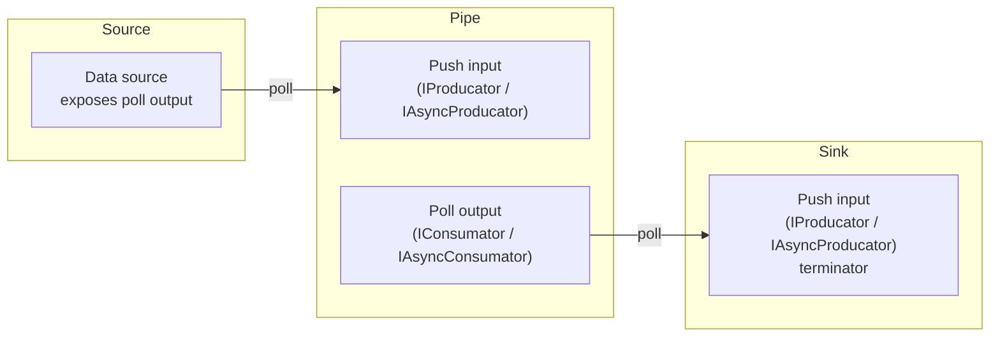

#  Steelax.Pufflow

> ⚡ **Pufflow. Just puff your flow**

[](https://www.nuget.org/packages/Steelax.Pufflow)
[](https://www.nuget.org/packages/Steelax.Pufflow/)

**Pufflow** — a library for building dataflow pipelines based on **Poll** and **Push** data transfer models and their
combinations. Pipeline components are plain classes annotated with `[Flow]`; a Roslyn source generator derives the
compile-time flow shape, and `FlowExt` connects components into type-safe chains.

---

## 📦 Installation

Core package (interfaces, markers, `FlowSource`, `FlowContext`, source generator):

```
dotnet add package Steelax.Pufflow
```

Standard operators (`Map`, `Filter`, `Buffering`, `Chunking`, `Warming`, `PeriodicRunner`, `MergeSources`, ...):

```
dotnet add package Steelax.Pufflow.Operators
```

Kafka integration (`OnKafkaSource` consumer source with watermark progress):

```
dotnet add package Steelax.Pufflow.Operators.Kafka
```

Test helpers (channel-backed sources and sinks for your own tests):

```
dotnet add package Steelax.Pufflow.Test.Sdk
```

---

## 🧠 Concept

The library defines **4 fundamental interfaces** for passing data between pipeline components.

### Poll (pull)

The Poll interface is the **read side** (output). Data is requested by the consumer. Pufflow's own consumers are
`IConsumator<T>` / `IAsyncConsumator<T>`; the standard .NET `IAsyncEnumerator<T>` is supported as a special case of
the poll model (`await foreach` friendly chains).

| Synchronous                    | Asynchronous                          |
|--------------------------------|---------------------------------------|
| `IConsumator<T>`               | `IAsyncConsumator<T>`                 |
|                                | `IAsyncEnumerator<T>` (std. .NET)     |

```csharp
public interface IConsumator<T> where T : allows ref struct
{
    bool TryRead([MaybeNullWhen(false)] out T value);  // non-blocking read
    bool IsCompleted { get; }                          // stream ended
}

public interface IAsyncConsumator<T> : IConsumator<T> where T : allows ref struct
{
    ValueTask<bool> WaitToReadAsync();                 // async wait
}
```

### Push (write)

The Push interface is the **write side** (input). Data is sent by the producer.

| Synchronous        | Asynchronous                    |
|--------------------|---------------------------------|
| `IProducator<T>`   | `IAsyncProducator<T>`           |

```csharp
public interface IProducator<in T> where T : allows ref struct
{
    bool TryWrite(T value);                 // non-blocking write
    bool TryComplete(Exception? ex = null); // completion / error signal
    bool IsFull { get; }                    // ring buffer is full
}

public interface IAsyncProducator<in T> : IProducator<T> where T : allows ref struct
{
    ValueTask<bool> WaitToWriteAsync();     // async wait
}
```

### Streaming semantics

- `TryRead` / `TryWrite` return a plain `bool` and do **not** block.
- `IsCompleted` tells whether the pull stream has ended; `IsFull` tells whether the push buffer is full.
- The async variants add `WaitToReadAsync` / `WaitToWriteAsync` for cooperative waiting between stages.

### Cursor

A pull consumer may additionally implement `ICursorable<T>` to peek the current element without committing to it
(useful for retries until the output has capacity) and advance only after it is fully handled:

```csharp
public interface ICursorable<T> where T : allows ref struct
{
    bool TryPeek([MaybeNullWhen(false)] out T value);
    void Advance();
    bool IsCompleted { get; }
}
```

> **Note:** Pufflow bridges its own consumers to the .NET enumerators in both directions via the
> `Steelax.Pufflow.Adapters` helpers (`AsyncEnumeratorByConsumator<T>`, `AsyncConsumatorByEnumerator<T>`), so
> enumerator-based stages can be mixed into consumator pipelines. Sync `IEnumerator<T>` chains are planned.

---

## 🏗️ Pipeline Components

Components in Pufflow fall into **3 roles**, encoded as zero-size marker structs:



| Role       | Marker Type           | Description                                                                     |
|------------|-----------------------|---------------------------------------------------------------------------------|
| **Source** | `Source<T>`           | A component that **only emits** data (poll output or a handed-in push target)   |
| **Sink**   | `Sink<T>`             | A component that **only accepts** data (push input or a handed-out push target) and terminates the pipeline |
| **Pipe**   | `Pipe<TLeft, TRight>` | A transformer: **push/pull input → push/pull output**                           |

The generic parameter is the flow interface itself (e.g. `Source<IAsyncConsumator<int>>`, `Pipe<IConsumator<int>, IProducator<string>>`),
so sync/async is encoded directly in the type — no separate `Sync`/`Async` tags are needed.

---

## 🔌 How It Works

### 1. Define a component with the `[Flow]` attribute

The component is a plain `partial` class whose **public constructor** declares the flow shape. The source generator
(`GetFlowGenerator`) analyzes the flow interface parameters (in/out `IConsumator` / `IProducator` and their async
variants, plus the optional trailing `FlowContext`). The role is derived from the number and direction of the flow
parameters:

- **out + read** (`out IConsumator<T>` / `out IAsyncConsumator<T>` / `out IAsyncEnumerator<T>`) → **Source** (emits a stream)
- **plain push target** (`IProducator<T>` / `IAsyncProducator<T>`) → **Source** (writes into the supplied target)
- **plain read** (`IConsumator<T>` / `IAsyncConsumator<T>` / `IAsyncEnumerator<T>`) → **Sink** (consumes the stream) or **Pipe input**
- **out + write** (`out IProducator<T>` / `out IAsyncProducator<T>`) → **Sink** (hands out a push target)
- **two flow parameters** → **Pipe** (in/out mix encodes input/output sides)

Any other constructor parameters are passed through to the generated `Configure(...)` factory:

```csharp
using Steelax.Pufflow;
using Steelax.Pufflow.Abstractions;

[Flow]
public partial class MySource
{
    // Source: emits integers via a poll interface. "rows" is a user argument.
    public MySource(int rows, out IAsyncConsumator<int> source, FlowContext context)
    {
        // ... build the stream; register background work via context.RegisterBackgroundProcess(...)
    }
}

[Flow]
public partial class MyTransform
{
    // Pipe: consumes a poll input, emits a poll output
    public MyTransform(IAsyncConsumator<int> input, out IAsyncConsumator<string> output)
    {
        // ... implementation
    }
}

[Flow]
public partial class MySink
{
    // Sink: consumes the poll stream and terminates the pipeline
    public MySink(IAsyncConsumator<string> input, FlowContext context)
    {
        context.RegisterBackgroundProcess(async ctx =>
        {
            // ... consume input using ctx.Token
        });
    }
}
```

For stateful stages a component registers background loops via `context.RegisterBackgroundProcess(...)` and signals
completion/errors through `IProducator.TryComplete(ex)`.

### 2. Source Generator produces `Configure(...)` factories

At compile time `GetFlowGenerator` analyzes the public constructor and generates a static `Configure(...)` factory on
the class, returning a lazy `Source<T>` / `Pipe<TLeft, TRight>` / `Sink<T>` marker. The concrete block instance is
constructed only when the chain is actually built.

### 3. Connect components via `FlowExt`

```csharp
using Steelax.Pufflow;

var pipeline = flow
    .On(MySource.Configure(rows: 100)) // FlowSource → Source<T>
    .Next(MyTransform.Configure())     // Source<T1> → Pipe<T1, T2> → Source<T2>
    .End(MySink.Configure());          // Source<T2> → Sink<T2>
```

### 4. Run the pipeline with `FlowSource`

```csharp
await using var flow = new FlowSource();

var pipeline = flow
    .On(MySource.Configure(rows: 100))
    .Next(MyTransform.Configure())
    .End(MySink.Configure());

// Starts all registered background tasks and awaits pipeline completion.
// Failure or external cancellation stops the whole pipeline.
await flow.ExecuteAsync(cancellationToken);
```

---

## ✨ Key Design Points

- **Compile-time composition, no reflection.** The Roslyn source generator (`GetFlowGenerator`) inspects the
  `[Flow]` constructor at compile time and emits typed `Configure(...)` factories. Chain links are typed delegates
  (`ConsumatorChain<T>`, `AsyncConsumatorChain<T>`, `ProducatorChain<T>`, `AsyncProducatorChain<T>`,
  `EnumeratorChain<T>`), so nothing is discovered or invoked via reflection at runtime.
- **Lazy construction.** A marker (`Source<T>` / `Pipe<TLeft, TRight>` / `Sink<T>`) only captures its user arguments
  as a closure; the concrete component instance is constructed when the chain is actually built (at `On` / `End`).
  Every constructed block is registered with the owning `FlowSource` and disposed when the pipeline finishes.
- **Non-blocking by design.** `TryRead` / `TryWrite` never block; stages cooperate through
  `WaitToReadAsync` / `WaitToWriteAsync`. `ICursorable<T>` lets a consumer peek the current element without
  committing to it, so a stage can hold and retry the same element (e.g. until the output has capacity) before
  advancing.
- **`ref struct` elements.** All flow interfaces are declared `where T : allows ref struct`, so value elements
  (including `Span<T>` and other `ref struct` payloads) can flow through a pipeline without allocation.
- **Standard iterator interop.** `IAsyncEnumerator<T>` is a first-class poll citizen (`await foreach`-friendly
  chains). The `Steelax.Pufflow.Adapters` bridge converts iterators to non-blocking consumators and back, so an
  awaiting stage never spins a thread while data is pending.
- **Fail-fast pipeline semantics.** `FlowSource.ExecuteAsync` starts every registered background process and waits
  for all of them. The first fault or cancellation cancels the whole pipeline; all collected exceptions are
  rethrown as an `AggregateException` after registered resources have been released.
- **Watermark-grounded streams.** Operators model progress explicitly: `Watermark` is a monotonic tick based on
  `Environment.TickCount64` (immune to wall-clock adjustments), and `Carrier<T>` packs a value or a bare progress
  marker with its watermark into a single envelope — no nested unions.

---

## 🧩 Supported Combinations

Components can mix poll and push in any combination. `🚧` marks chains that are planned but not yet implemented.

### Pull chains (Poll → Poll)

| Left side                          | Right side                     | Status |
|------------------------------------|--------------------------------|:------:|
| `IAsyncEnumerator<T>`              | `IAsyncEnumerator<TY>`         |   ✅    |
| `IAsyncEnumerator<T>`              | `IAsyncConsumator<TY>`         |   ✅    |
| `IConsumator<T>`                   | `IConsumator<TY>`              |   ✅    |
| `IAsyncConsumator<T>`              | `IAsyncConsumator<TY>`         |   ✅    |
| `IConsumator<T>`                   | `IAsyncConsumator<TY>`         |   ✅    |
| `IAsyncConsumator<T>`              | `IConsumator<TY>`              |   ✅    |
| `IAsyncConsumator<T>`              | `IAsyncEnumerator<TY>`         |   ✅    |
| `IEnumerator<T>` (sync)            | `I[Async]Enumerator<TY>` / `I[Async]Consumator<TY>` | 🚧 |

### Push chains (Push → Push)

| Left side              | Right side           | Status |
|------------------------|----------------------|:------:|
| `IProducator<T>`       | `IProducator<TY>`    |   ✅    |
| `IProducator<T>`       | `IAsyncProducator<TY>` |  ✅    |
| `IAsyncProducator<T>`  | `IProducator<TY>`    |   ✅    |
| `IAsyncProducator<T>`  | `IAsyncProducator<TY>` |  ✅    |

### Mixed chains (Poll ↔ Push)

| Left side                     | Right side                     | Notes                        | Status |
|-------------------------------|--------------------------------|------------------------------|:------:|
| `IConsumator<T>`              | `IProducator<TY>`              | pull → push pipe             |   ✅    |
| `IConsumator<T>` / `IAsyncConsumator<T>` | `IAsyncProducator<TY>` | pull → push pipe     |   ✅    |
| `IAsyncConsumator<T>`         | `IProducator<TY>`              | pull → push pipe             |   ✅    |
| `IProducator<T>`              | `IConsumator<TY>`              | composite push → pull (buffer) | ✅    |
| `IAsyncProducator<T>`         | `IConsumator<TY>`              | composite push → pull (buffer) | ✅    |
| `IProducator<T>` / `IAsyncProducator<T>` | `IAsyncConsumator<TY>` | composite push → pull (buffer) | ✅ |

### Sinks

| Left side                     | Marker type                          | Status |
|-------------------------------|--------------------------------------|:------:|
| `IAsyncEnumerator<T>`         | `Sink<IAsyncEnumerator<T>>`          |   ✅    |
| `IConsumator<T>` / `IAsyncConsumator<T>` | `Sink<IConsumator<T>>` / `Sink<IAsyncConsumator<T>>` | ✅ |
| `IProducator<T>` / `IAsyncProducator<T>` | `Sink<IProducator<T>>` / `Sink<IAsyncProducator<T>>` | ✅ |

---

## 🚰 Operators

`Steelax.Pufflow.Operators` provides ready-to-use pipe stages:

```csharp
using Steelax.Pufflow;
using Steelax.Pufflow.Operators;

var pipeline = flow
    .OnAsyncConsumatorSource(Enumerable.Range(1, 100)) // Source<IAsyncConsumator<int>> (test SDK)
    .Map(static v => v * 10)                           // 1:1 projection
    .Filter(static v => v % 3 != 0)                    // element filtering
    .Chunking(10, TimeSpan.FromMilliseconds(100))      // grouping into pooled Chunk<T>
    .Consume(out var reader);                          // sink (test SDK)
```

> `OnAsyncConsumatorSource` and `Consume` in the snippet are helpers from `Steelax.Pufflow.Test.Sdk`; in your own
> code you plug components in via `On` / `Next` / `End`.

| Operator                                               | Description                                                                                  |
|--------------------------------------------------------|----------------------------------------------------------------------------------------------|
| `Map<TSource, TTarget>(selector)`                      | Projects each element 1:1 (sync/async consumator & producator streams, plain and `Carrier<T>`). |
| `Filter(predicate)`                                    | Keeps only elements that satisfy the predicate (sync/async consumator & producator streams).   |
| `Buffering(capacity)`                                  | Decouples a push producer from a pull consumer over a bounded passive buffer (push → pull).    |
| `Chunking(minimumSize, linger, strategy)`              | Groups consecutive elements into pooled `Chunk<T>`; carrier variant accumulates watermarks.    |
| `Warming(options)`                                     | Fluent builder: `.PartitionBy(keySelector).Prefetch(jobFactory, policy).Accumulate(accumulatorFactory)`; warms streams in key segments and emits `Carrier<Unio<TValue, TGroup>>` (or plain `Carrier<TValue>` via the short `Accumulate` overload). |
| `PeriodicRunner(handler)`                              | `.Every(period)` — values pass through, while the stream's watermark is held back and released once per interval after the handler runs. |
| `Expand(selector)`                                     | 1:N expansion of carrier elements into zero or more outputs (via a reusable `QueueSpan<T>` buffer). |
| `MergeSources(params IAsyncConsumator<Carrier<T>>[])`  | Merges several pull sources into one; the watermark advances as the minimum across sources (round-based barrier). |
| `Expose(out IAsyncConsumator<T>)`                      | Terminates the pipeline and hands the pull side out externally (e.g. to feed `MergeSources`). |
| `Timeout(timeout)`                                     | 🚧 Planned — races each wait against a timeout, emitting `Unio<T, AwaitTimeout>` markers.       |

Kafka (`Steelax.Pufflow.Operators.Kafka`):

```csharp
var source = flow
    .OnKafkaSource(options)                       // fluent builder
    .WithErrorPolicy(KafkaErrorPolicy.Default)    // optional
    .Use(consumer, WatermarkTracker.Create());    // Fuse<IProducator<Carrier<ConsumeResult<TKey, TValue>>>>
```

The Kafka source emits `Carrier<T>` elements whose payload is a `ConsumeResult` when a record is available, or a bare
progress watermark when consumption has been quiet. The consumer's progress is tracked in a pool of windows; each
consecutive run of records is windowed, and the windows are committed once the downstream reader confirms them
through the shared `WatermarkTracker` (`SetProgress` / `GetProgress`). One tracker can be shared between several
sources — e.g. all inputs of a `MergeSources` — so the merged reader's progress is visible to every contributor.

Additional tuning:

- **Idle progress markers.** While the source is quiet, a bare progress marker is emitted periodically (every
  `WatermarkAdvanceInterval`), keeping the stream's watermark alive so merged streams (whose watermark is the
  minimum over the sources) never stall the other inputs' commits.
- **Offset advancing.** `AdvanceStrategy.OffsetStore` stores offsets locally for the auto-commit background thread;
  `AdvanceStrategy.ManualCommit` commits offsets to the broker synchronously.
- **Error handling.** `KafkaErrorPolicy` decides how consume and advance (commit) errors are treated:
  `Default` (suppress transient errors), `Strict` (fault the pipeline), or a fully custom policy via
  `KafkaErrorPolicy.CreateCustom(...)`.

The builder also accepts `WithCustomProviders(watermarkProvider, timeProvider)` to swap in deterministic
watermark/time sources for tests.

---

## ♻️ Lifecycle Management

`FlowSource` owns cancellation and background tasks for the whole pipeline:

```csharp
await using var flow = new FlowSource();   // also IDisposable

flow.Context.TryCancel(new Exception());   // cancel the pipeline and fault it
flow.Dispose();                            // cancel + free resources
await flow.DisposeAsync();                 // async variant

// An external token can stop the pipeline when it is run
await flow.ExecuteAsync(externalToken);
```

`FlowContext` provides:

| Member                 | Description                                                                                     |
|------------------------|-------------------------------------------------------------------------------------------------|
| `Token`                | The stage's `CancellationToken`; `FlowContext` converts implicitly to `CancellationToken`.       |
| `TryCancel(Exception)` | Cancels the whole pipeline and records the fault (surfaced later by `ExecuteAsync`).            |
| `RegisterBackgroundProcess(Func<FlowContext, Task>)` | Registers a background task started lazily by `FlowSource.ExecuteAsync` (typed overload `RegisterBackgroundProcess<TArgs>(Func<FlowContext, TArgs, Task>, TArgs)` also exists). |
| `OnCancelled(Action<CancellationToken>)` | Registers a callback that runs when the pipeline is canceled.                            |

The `FlowSource` itself exposes:

| Member                     | Description                                                                           |
|----------------------------|---------------------------------------------------------------------------------------|
| `RegisterDisposable(object)`| Registers a resource (`IDisposable` / `IAsyncDisposable`) released after the pipeline completes. |
| `ExecuteAsync(ct)`         | Starts all registered background tasks and waits for them; a fault or cancellation cancels the whole pipeline and its aggregated exceptions are rethrown; registered resources are released afterwards. |

---

## 🧪 Current Status

| Feature                                                   |     Status     |
|-----------------------------------------------------------|:--------------:|
| Async poll chain (`IAsyncEnumerator`)                     | ✅ Implemented  |
| Async poll chain (`IAsyncConsumator`)                     | ✅ Implemented  |
| Sync poll chain (`IConsumator`)                           | ✅ Implemented  |
| Push chain (`IProducator` / `IAsyncProducator`)           | ✅ Implemented  |
| Poll↔Push combinations (Pipe, incl. composite push→pull)  | ✅ Implemented  |
| Poll↔Enumerator bridges (`IAsyncConsumator` ↔ `IAsyncEnumerator`) | ✅ Implemented  |
| Sync enumerator chains (`IEnumerator`)                    | 🚧 Planned      |
| Operators: `Map`, `Filter`, `Buffering`, `Chunking`, `Warming`, `PeriodicRunner`, `Expand`, `MergeSources`, `Expose` | ✅ Implemented |
| Operator: `Timeout`                                       | 🚧 Planned      |
| Kafka consumer source                                     | ✅ Implemented  |
| Source Generator (`[Flow]` → `Configure(...)` factories)  | ✅ Implemented  |

---

## 📋 Requirements

- .NET 10.0+
- C# 14+

---

## 🛠️ Build

```
dotnet build
dotnet test
```